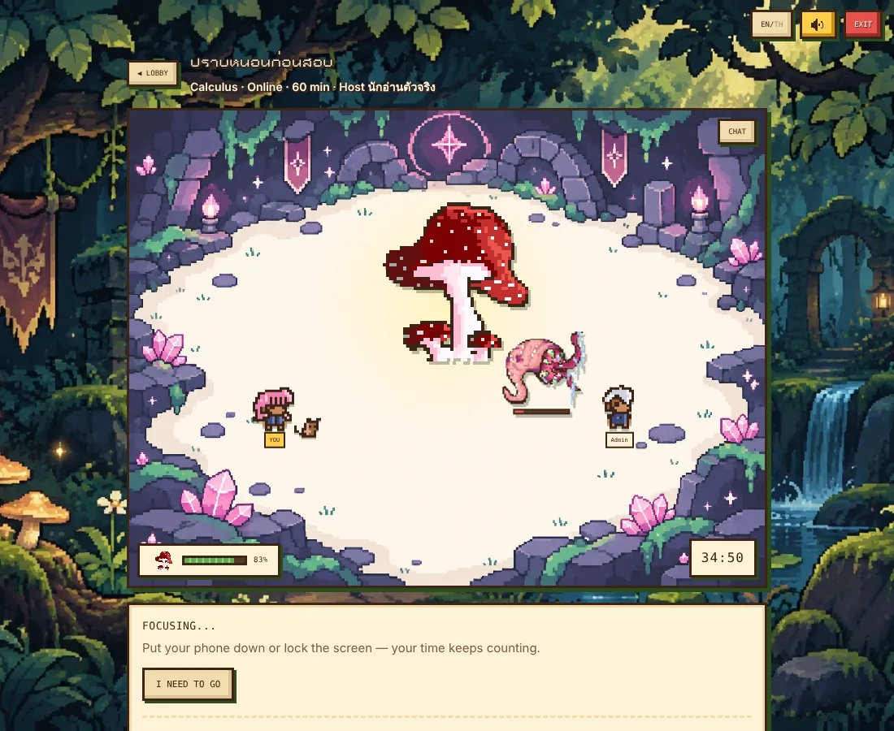
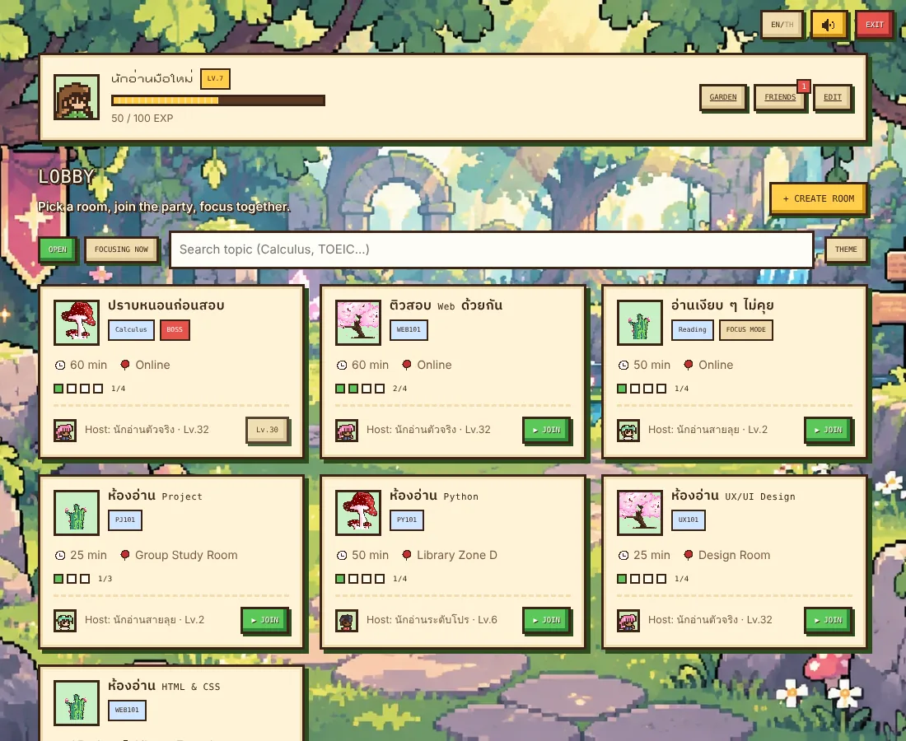
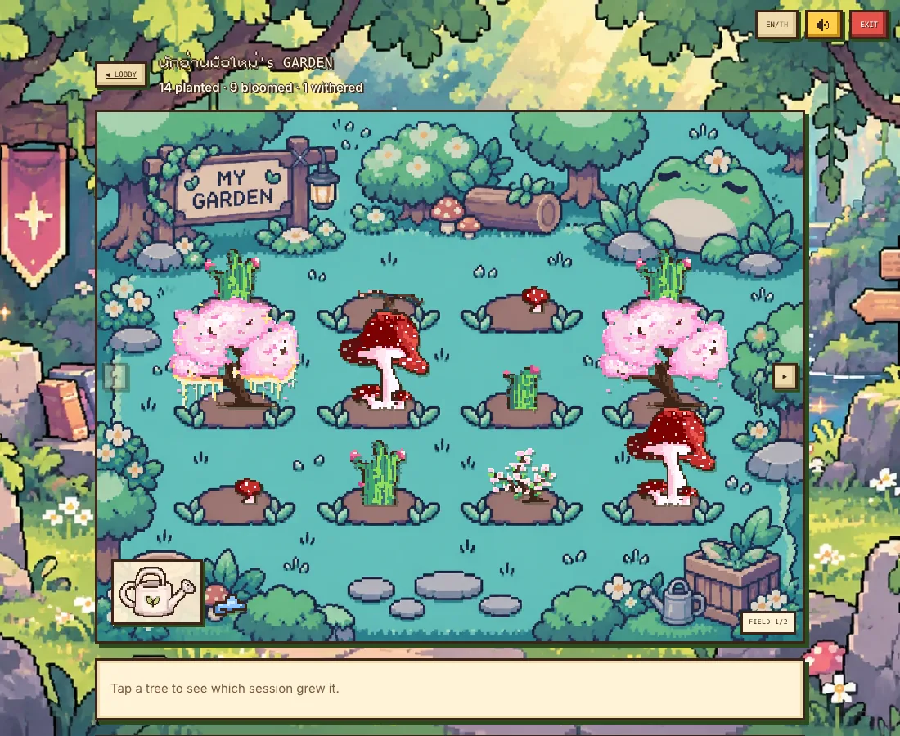
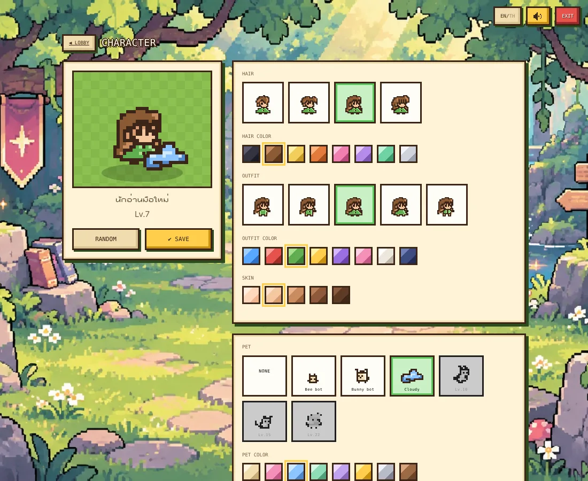

# Focus Party
https://focus-party.onrender.com/login

A pixel-art **co-focus game**: study together in shared rooms, grow a tree with everyone who stays focused,
and fight a pest that attacks your tree. Every focused minute counts. Leave early and your tree (and your EXP) pays for it.



| Lobby | Garden | Character & pets |
|---|---|---|
|  |  |  |

All art (characters, pets, trees, the pest, backgrounds, icons) is hand-drawn for this project.

## Features

- **Focus rooms**: host a room (15–180 min), pick a tree and a theme, optional breaks. Players sit around a shared
  tree that grows in real time. Chat can be turned off ("focus mode").
- **Fair rules**: leaving before half-time costs EXP. Stay to the end and harvest within 10 minutes for the bonus.
- **Boss fights** (Lv.30+): each room gets its own pest. Every focused minute is 1 damage per player.
  The tree grows every ⅓ of the pest's HP, and the special *win* tree only appears when it dies.
- **Garden**: every session plants a tree. Name them and water them all at once. Neglected trees die
  (30–180 days depending on size) and come back after 5 days of watering. 4 garden themes unlock by level.
- **Characters & pets**: pixel avatars and 6 pets unlocked by level, all recoloured live on a canvas from one grey drawing.
- **Friends**: requests, privacy setting, visit friends' gardens.
- Thai / English, background music, 6 page themes, mobile layout, admin account to preview every level.

## Tech

| | |
|---|---|
| Frontend | React 18 + Vite, React Router, Axios: `frontend/` |
| Backend | Yii2 REST API with Bearer-token auth: `controllers/`, `models/` |
| Database | MySQL / MariaDB / TiDB, schema and demo data as migrations: `migrations/` |
| Real-time | REST polling (room every 5 s, chat every 3 s) with server-time sync |
| Game rules | one formula set, mirrored in `components/Rules.php` and `frontend/src/rules.js` |
| Deploy | one Docker container (Apache + PHP 8.3) serving the API and the built React app |

The React app also ships with a full **mock backend** (`frontend/src/api/mock.js`) so the UI can be developed
and demoed without PHP.

## Demo accounts

| Username | Password | |
|---|---|---|
| `admin` | `Admin1234` | Lv.30, can set its own level (1–60) |
| `focus_demo1` | `Focus1234` | garden with 14 trees, friends, a pending request |
| `focus_demo3` | `Focus1234` | Lv.32, hosts a boss room |

## Run locally

Needs PHP 8.2+, Composer, MySQL/MariaDB, Node 18+.

```bash
composer install
cp .env.example .env          # set DB_USERNAME / DB_PASSWORD, create the database "focus_party"
php yii migrate               # tables + demo data
php yii serve --port=8080     # API

cd frontend && npm install && npm run dev   # http://localhost:5173 (mock data by default)
```

To use the real API in dev, put `VITE_USE_MOCK=false` in `frontend/.env`.
`npm run build` writes the app into `web/`, which is committed so the server needs no Node.

## Deploy (free): Render + TiDB Cloud

1. **Database**: on [TiDB Cloud](https://tidbcloud.com) create a free *Starter* instance, open the SQL editor
   and run `CREATE DATABASE focus_party;`. Under **Connect**, copy the host, port, user and password.
2. **App**: on [Render](https://render.com) choose **New → Blueprint** and pick this repo (`render.yaml`).
   Fill in:
   - `DB_DSN` = `mysql:host=<host>;port=4000;dbname=focus_party`
   - `DB_USERNAME`, `DB_PASSWORD`
3. Deploy. On start the container runs the migrations by itself. Check `/api/test`.

Render's free plan sleeps after 15 minutes without visitors; the first visit after that takes about a minute.

## API

All responses are `{"data": ...}`; errors are `{"message", "errors"}`. See `config/web.php` for every route:
auth, me (avatar, settings, garden, watering), rooms (create / join / start / leave / claim / chat),
boss templates, friends, visiting gardens, admin level.

## Credits

- Fonts: [Press Start 2P](https://fonts.google.com/specimen/Press+Start+2P) (OFL),
  [IBM Plex Sans Thai](https://fonts.google.com/specimen/IBM+Plex+Sans+Thai) (OFL), TA 8 bit by TA Font
- Built on the [Yii 2 basic template](https://github.com/yiisoft/yii2-app-basic) (BSD-3-Clause, see `LICENSE.md`)
